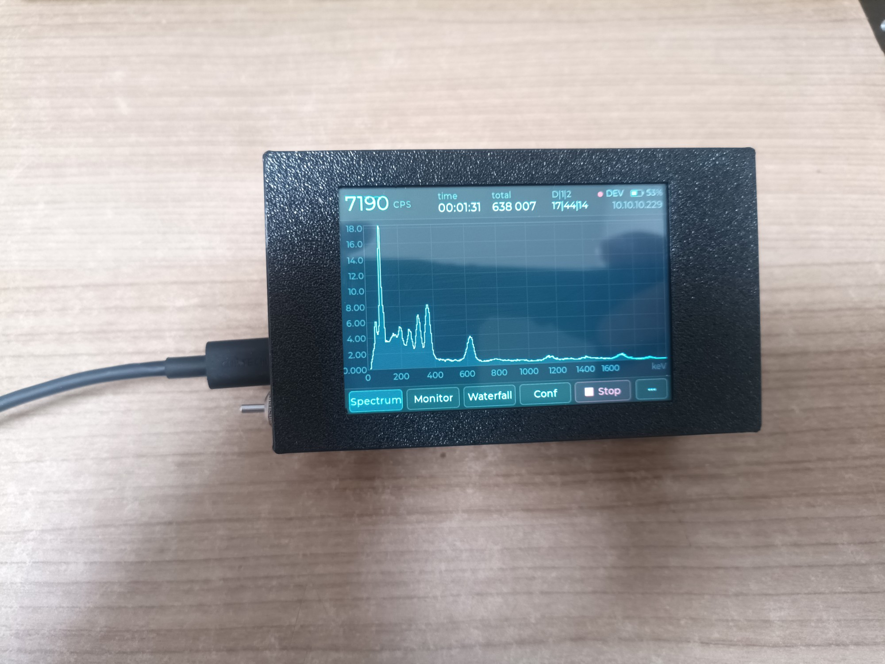
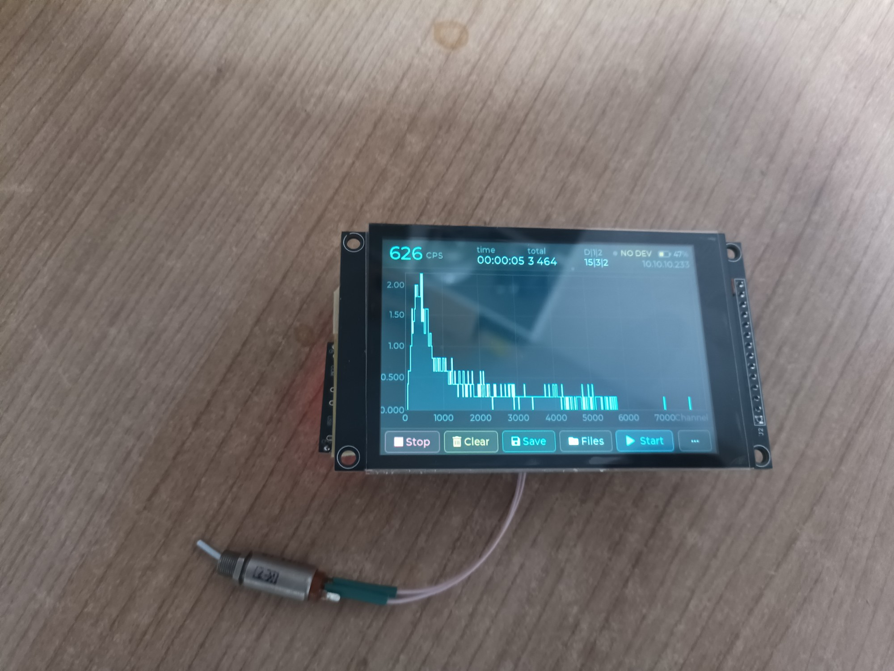
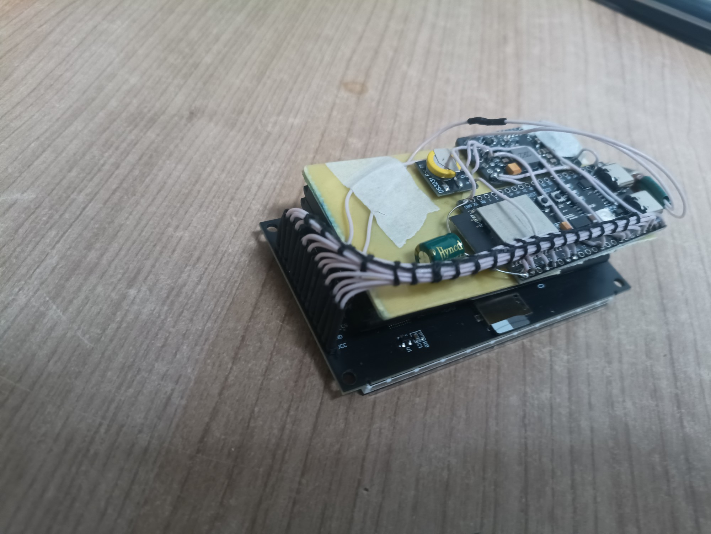

# AtomSpectra Handheld (ESP32-S3)

[Русская версия](README.md)

A standalone handheld unit for the **KB Radar "Atom Spectra"** gamma spectrometer:
ESP32-S3 + 3.5" touch display + battery with a charger module + real-time clock +
microSD. Spectrum, CPS monitoring and waterfall are shown right on the device screen —
no phone or computer needed — and the full web UI is available over WiFi.

> **Based on [atomspectra-waterfall-esp32](https://github.com/VibeEngineering-LLC/atomspectra-waterfall-esp32)
> by VibeEngineering LLC** (forked from `firmware-v1.1.2`, MIT license).
> USB spectrum acquisition, the web UI, the waterfall and the ASWF format, the TCP bridge
> for BecqMoni / AtomSpectra and the field WiFi mode are the work of the original authors.
> Thank you! The original documentation is in [docs/upstream](docs/upstream/README.en.md).



## Main differences from the original project

### 1. 3.5" touch display — a device without a phone

lcdwiki 3.5" IPS ST7796 module (480×320, SPI) with an FT6336U capacitive touch panel.
The screen is a mini copy of the web UI (LVGL 8):

- **Spectrum** — live spectrum (linear, double tap for log), keV axis from the device
  calibration; header with CPS, acquisition time, total, CPU load, device status (the dot
  blinks red while acquiring) and battery level.
- **Monitor** — CPS per interval and moving average (session shared with the web UI).
- **Waterfall** — spectrogram in the Inferno palette.
- **Conf** — Indoor / Outdoor network mode, **WiFi setup from the screen** (network scan,
  password on an on-screen keyboard, checked before saving), channel window.
- **Start / Stop** (one button that follows the state), Clear, Save, **Files** — browse
  the card and open saved spectra on the plot.
- 5-point touch calibration (web UI "System" page).



### 2. BQ25895 charger module — battery operation

- Runs from a Li-ion battery, charges over USB-C (charge current set in the web UI).
- The spectrometer gets **5 V from the battery** through the module's boost converter
  (OTG mode) — the unit is fully standalone.
- Battery level and charging status on the screen and in the web UI; charger registers
  and fault diagnostics on the "System" page.

### 3. DS3231 clock — correct time without internet

- Time is kept by a battery-backed clock and set at power-up — spectrum, waterfall and
  monitoring timestamps are right in the field, without SNTP or a phone.
- The clock is corrected from SNTP or the browser when available.

### And also

- **microSD** (display module slot): saved spectra, waterfall segments, monitoring
  sessions (CSV), autosave of the live spectrum. No user data goes to internal flash —
  flash writes disturbed USB data reception.
- **"Files"** web page: view (spectrum plot, monitoring CSV, waterfall image), download,
  delete one or many.
- **Firmware update over WiFi** by file upload ("System" page), with rollback if the new
  firmware does not start.
- Ported fixes from newer original releases: recovery from USB stalls, acquisition
  watchdog (restarts acquisition after a device reboot), spectrum kept across a device
  power loss, calibration read from the device, safer delete, command retry after a
  board reboot.
- Removed: W5500 Ethernet (its pins went to the display and the card).

## Hardware

| Part | Connection |
|---|---|
| Board | ESP32-S3-DevKitC-1 **N16R8** (16 MB flash, 8 MB PSRAM) |
| Spectrometer | USB (ESP32-S3 USB-OTG, GPIO19/20), as in the original — see [INSTALL.en.md](INSTALL.en.md) |
| ST7796 display (SPI2) | CS 4, DC 5, MOSI 11, SCLK 12, MISO 13, RST 14; 3.3 V supply |
| microSD (display slot) | CS 10, SPI bus shared with the display |
| FT6336U touch (I2C) | SDA 8, SCL 9, RST 7, INT 15, address 0x38 |
| BQ25895 charger (I2C) | SDA 8, SCL 9, address 0x6A |
| DS3231 clock (I2C) | SDA 8, SCL 9, address 0x68; **3.3 V** supply |
| WS2812 RGB LED | GPIO48 |



## Firmware

**Prebuilt** — see [Releases](../../releases):

- `firmware.factory.bin` — full image for the first USB flash:
  `esptool.py --chip esp32s3 -p COMx -b 460800 write_flash 0x0 firmware.factory.bin`.
  Erases settings (WiFi has to be entered again).
- `atomspectra_gw.bin` — for WiFi updates: web UI → "System" → "Upload firmware over
  WiFi". Settings and data are kept.

OTA partition table (`ota_0`/`ota_1`, 3 MB each). Moving from the original project or
from a build without OTA requires one USB flash.

**From source** — ESP-IDF v5.4:

```
idf.py set-target esp32s3   # once
idf.py build
idf.py -p COMx flash monitor
```

First start: the board opens the `AtomSpectra-Setup` access point — pick your home
network in the portal, or set WiFi up right on the screen (Conf → WiFi).

## Documentation

- [INSTALL.en.md](INSTALL.en.md) — spectrometer connection and first setup (original project)
- [PROTOCOL.en.md](PROTOCOL.en.md), [WATERFALL.en.md](WATERFALL.en.md), [ASWF_FORMAT.en.md](ASWF_FORMAT.en.md) — device protocol, waterfall, file format
- [KNOWN_ISSUES.en.md](KNOWN_ISSUES.en.md) — known limitations
- [CLAUDE.md](CLAUDE.md) — detailed development notes: decisions, measurements, pitfalls (Russian)
- [docs/upstream](docs/upstream/README.en.md) — the original README

## License

MIT — see [LICENSE](LICENSE). Original project © 2026 VibeEngineering LLC; changes in
this fork © 2026 atomspectra-handheld-esp32 contributors.

This device is not a certified measuring instrument — see the original disclaimer in
[docs/upstream](docs/upstream/README.en.md).
